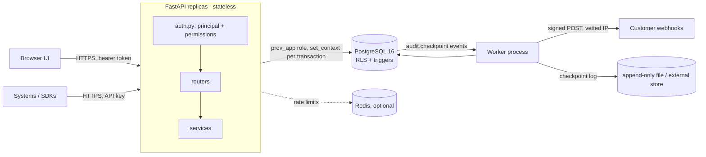
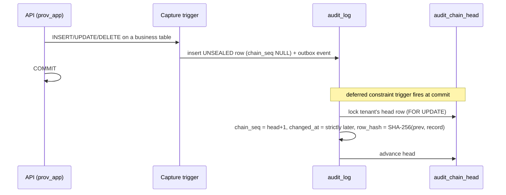

# Architecture

Provenance Cloud is a **modular monolith**: one FastAPI codebase, one PostgreSQL database, one background worker. There are no microservices because nothing here needs independent deployment, and the core guarantees (audit chain, tenant isolation, transactional outbox) are strongest when they live in one transactional boundary. See [ADR 0004](adr/0004-modular-monolith.md).

## Request lifecycle

1. **Middleware** assigns/validates `X-Request-ID`, enforces the body-size limit, and later adds security headers, JSON access log and metrics.
2. **Authentication** (`app/auth.py`). A bearer token starting `prv_` is an API key, anything else is a JWT. Both resolve to a `Principal` (tenant, actor, permissions). A user's permissions come from their *current* role in the database, so demotion and deactivation apply instantly; an API key's permissions are its scopes.
3. **Connection scoping** (`app/db.py`). The request borrows a pooled connection logged in as `prov_app`. The first statement of every transaction is `SELECT prov.set_context(tenant, user, actor, request_id)`, which uses `set_config(..., is_local => true)`. The context disappears at COMMIT/ROLLBACK, so a pooled connection (or PgBouncer in transaction mode) can never carry one request's identity into the next.
4. **Row-level security** filters every statement to that tenant; with no context every policy is false and nothing is visible (fail closed).
5. **Handlers** run SQL directly (no ORM). Money is `numeric`/`Decimal` end to end. Writes commit explicitly; anything not committed is rolled back when the session closes.
6. **Triggers** capture provenance in the same transaction (below).

## The audit chain

Sealing at **commit** instead of at the moment of change is deliberate: the chain-head lock becomes the last lock a transaction takes and is held only for the commit itself. Sealing inline would hold it for the whole transaction, serialise every writer in the organization and invite lock-order deadlocks. A side effect worth having: `chain_seq` is *commit order*, so "state as of record N" and "state as of time T" always agree, and no reader ever sees an unsealed row.

The hash preimage is a JSON array (`["v1", prev, seq, tenant, entity, pk, op, actor, actor_id, request, change_request, db_user, epoch_micros, old, new]`), so field boundaries are unambiguous and independent of any session time zone.

**Integrity layers**

| Layer | Catches | Does not catch |
|---|---|---|
| Append-only trigger + privileges | Any edit/delete by the application role or ordinary users | An owner/superuser who disables the trigger |
| Hash chain (`prov.audit_verify`) | Edit, delete, re-order, truncation of the tail, rows written with sealing disabled | An attacker who recomputes every hash |
| **Signed checkpoints** (Ed25519, key outside the DB) | A recomputed/rewritten chain, truncation | Compromise of the signing key |
| **Checkpoints you keep outside the system** (webhook `audit.checkpoint`, anchor file) | All of the above, even if the attacker deletes the stored checkpoints | Nothing in this list; it is the root of trust |

The worker performs a **full** verification on a schedule (`FULL_VERIFY_INTERVAL_SECONDS`) and signs a checkpoint only if it passes, then publishes it. A failure raises a CRITICAL `DQ004` alert and an `audit.integrity_failed` event instead.

## Transactional outbox and webhooks

Triggers (and application code via `emit_event`) insert into `outbox_events` in the same transaction as the change, so an event exists if and only if the change committed.

The worker (any number of them) then:

1. **fan-out**: claims pending events with `FOR UPDATE SKIP LOCKED`, creates one `webhook_deliveries` row per matching, *already-existing* subscription (unique `(webhook_id, event_id)` makes it idempotent), marks events dispatched.
2. **claim**: leases due deliveries (`locked_until`) and commits the lease.
3. **send**: HTTP call outside any transaction. The hostname is resolved once, **every** address must be public, and the request goes to that exact IP with the original `Host`/SNI. Redirects are never followed. This closes DNS-rebinding SSRF.
4. **record**: `SUCCESS`, or `FAILED` with exponential backoff (15 s doubling, ±20 % jitter, 6 h cap; about 8 hours across the default 12 attempts), or `DEAD` after `WEBHOOK_MAX_ATTEMPTS` (a `WH001` alert is raised; an admin can retry).

A worker that dies mid-send simply lets its lease expire: delivery is **at-least-once**. Receivers dedupe on the stable `webhook-id` header. Signatures follow Standard Webhooks (`v1,base64(HMAC-SHA256(secret, "{id}.{timestamp}.{body}"))`); signing secrets are encrypted at rest with AES-256-GCM, bound to the tenant.

## Ingestion and reconstruction

External events are CloudEvents. An event with `subject` = `<entity>/<external id>` and Debezium-style `data` (`op`, `before`, `after`) describes a change to one record in an upstream system. The unique key `(tenant, source, event id)` makes retries idempotent in the database (`ON CONFLICT DO NOTHING`); a trigger stamps trust level and capture method from the registered source so a sender cannot claim its own. Every accepted event is itself audited (hash-chained) and published to the outbox.

Reconstruction (`app/services/records.py`) takes the latest event at or before a time, honours deletes, and is **bitemporal**: `at` is when it happened in the source, `known_at` filters by when we received it. Out-of-order arrival is resolved by occurrence time.

## Background work and scaling

| Concern | Design |
|---|---|
| API replicas | Stateless. Scale horizontally; only the connection pool (`DB_POOL_MAX` × replicas) must fit in PostgreSQL's `max_connections`, or put PgBouncer (transaction mode, `DB_PREPARED_STATEMENTS=false`) in front. |
| Workers | Run `python -m app.worker` as separate processes; any number may run concurrently (leases, `SKIP LOCKED`, unique keys). `WORKERS_ENABLED=true` embeds one in the API for laptops. |
| Rate limits | Per client address (login), per user, per API key. Redis if `REDIS_URL` is set (shared across replicas), otherwise per process; falls back to memory if Redis is down. |
| Write hot spot | One lock per organization at commit (the chain head). Measured on a developer laptop: ≈1,400 audited single-row transactions/s from one client, ≈3,000/s from several, in one organization ([TESTING](TESTING.md#measurements)). Different organizations do not contend. |
| Data growth | Operational tables are pruned by the worker; `audit_log` and `external_events` are retained forever by design. Partitioning is **not** implemented; see [DATABASE](DATABASE.md#growth-and-partitioning) for when and how. |

## Platform administration

A second, separate surface: `/platform` (UI) and `/api/platform/v1`, operated by platform operators with TOTP MFA, connecting to PostgreSQL as `prov_platform` (no tenant table privileges) through its own connection pool, and recording every request in its own hash chain with signed checkpoints written to an independent anchor. Break-glass reads go back through the ordinary RLS path in a database-enforced read-only transaction. See [PLATFORM_ADMIN](PLATFORM_ADMIN.md) and [ADR 0009](adr/0009-platform-admin-and-break-glass.md).

## Module map

| Module | Responsibility |
|---|---|
| `config.py` | Environment settings; `problems()` blocks unsafe production config |
| `auth.py` / `routers/auth.py` | Principals, permissions; sign-up, login, rotating refresh tokens, password change |
| `db.py` | Pool, transaction-local context, savepoints, JSON codecs |
| `errors.py` | RFC 9457 responses; SQLSTATE → HTTP/`code` mapping |
| `services/integrity.py` | Chain verification, checkpoints, anchor file |
| `services/provenance.py` | History, as-of, compare, explain, lineage, request trace |
| `services/rules.py` | Anomaly and data-quality rules, alert de-duplication |
| `services/webhooks.py` | Fan-out, leases, SSRF-safe delivery, signing, backoff |
| `services/ingestion.py`, `records.py`, `reconcile.py`, `imports.py` | External events, reconstruction, reconciliation, CSV |
| `services/idempotency.py` | `Idempotency-Key` for unsafe POSTs |
| `worker.py` | Scheduler loop |
