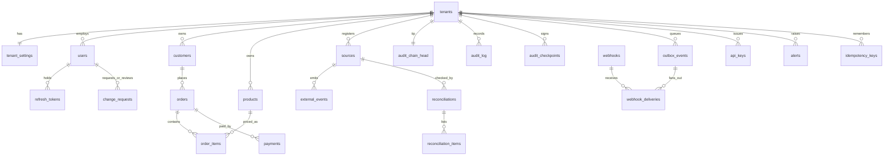

# Database

PostgreSQL 16, schema `prov`. The schema is created by Alembic revision `0001`, which executes four SQL files from [`migrations/sql/`](../migrations/sql/):

| File | Contents |
|---|---|
| `0001_01_core.sql` | request-context functions, organizations, users, refresh tokens, the commerce ledger, business-rule triggers |
| `0001_02_audit.sql` | outbox, audit log, chain head, checkpoints, hashing, sealing, verification, capture triggers |
| `0001_03_platform.sql` | alerts, change requests, webhooks, API keys, sources, external events, reconciliation, idempotency |
| `0001_04_security.sql` | row-level security, privileged entry points, grants |
| `0003_01_platform.sql` (revision `0003`) | platform operators, break-glass grants, platform audit chain and checkpoints, organization status, metadata functions, grants for `prov_platform` |
| `0002_01_activity_log.sql` (revision `0002`) | append-only security activity log with client IP (`inet`), RLS, immutability triggers |

## Entity relationships



Every tenant-owned table carries `tenant_id bigint NOT NULL DEFAULT current_tenant_id()`, so application code never supplies it and RLS verifies it anyway. Relationships between tenant-owned tables use composite `(tenant_id, id)` foreign keys, which make a cross-tenant reference impossible *even for a superuser who bypasses RLS* (tested).

## Roles and privileges

| Role | Purpose | Notes |
|---|---|---|
| `prov_owner` | Owns all objects; runs migrations | Exempt from RLS as table owner. Not used by the running API or worker. |
| `prov_app` | API and worker | `NOSUPERUSER NOBYPASSRLS`, owns nothing. DML on business tables; **SELECT only** on `audit_log`, `audit_chain_head`; `INSERT`+`SELECT` on `audit_checkpoints`; no access to the audit functions that write history. |
| `prov_platform` | Platform console only ([PLATFORM_ADMIN](PLATFORM_ADMIN.md)) | `NOSUPERUSER NOBYPASSRLS`, owns nothing, **no privileges on any tenant table**. Reads/writes platform tables; reaches tenant metadata and account recovery only through narrow `SECURITY DEFINER` functions. Created `NOLOGIN` if `DATABASE_PLATFORM_URL` is unset. |
| `postgres` (admin) | Only `app.cli bootstrap` | Creates the two roles, database and schema. |

`SECURITY DEFINER` functions (all with a pinned `search_path`) are the only privileged entry points: `audit_append`, `audit_seal`, `audit_capture` (trigger-only, not granted), and four narrow lookups that authentication needs *before* a tenant is known: `auth_user_by_email`, `auth_api_key`, `auth_refresh_token`, `create_organization`. Each does one exact-key lookup and cannot list data. `worker_tenants` returns tenant ids; `prune_operational_data` deletes only delivered/old operational rows and never touches `audit_log`, `audit_checkpoints` or `external_events`.

## Tenant context and row-level security

```sql
current_tenant_id()  -- NULLIF(current_setting('app.tenant_id', true), '')::bigint
set_context(tenant, user, actor, request_id)  -- set_config(..., true): transaction-local
CREATE POLICY tenant_isolation ON <table>
  USING (tenant_id = (SELECT current_tenant_id()))
  WITH CHECK (tenant_id = (SELECT current_tenant_id()));
```

No context → `NULL` → every comparison is unknown → no rows, and inserts fail the `WITH CHECK`. `tests/test_tenancy.py` asserts that every table with a `tenant_id` has RLS enabled and a policy, so a new table cannot silently ship unprotected.

## Business rules enforced in the database

| Rule | Mechanism | Error code |
|---|---|---|
| Order status machine | `orders_guard` + `order_status_transitions` | `ORDER_INVALID_TRANSITION` (PV001) |
| Items editable only while `CREATED` | `order_items_guard` (takes the order row lock, so it cannot race a status change) | `ORDER_ITEMS_LOCKED` (PV002) |
| Total is derived, never set | `orders_guard` ignores client totals on insert and rejects direct changes; `order_items_recalculate_total` maintains it | `ORDER_TOTAL_DERIVED` (PV003) |
| Four-eyes approval | `CHECK (reviewed_by_id <> requested_by_id)` | `FOUR_EYES` |
| Decided change requests are final | `change_requests_guard` | `CHANGE_REQUEST_DECIDED` (PV030) |
| An organization keeps ≥ 1 active admin | deferred constraint trigger (serialised per tenant) | `LAST_ADMIN` (PV020) |
| Event trust comes from the source | `external_events_stamp` | `SOURCE_UNKNOWN`/`SOURCE_PAUSED` |
| Audit/checkpoint/event immutability | `audit_guard`, `reject_mutation`, no UPDATE/DELETE grants | `APPEND_ONLY` (PV901) |

Trigger order matters and is encoded in names: for the same event PostgreSQL fires triggers alphabetically, so `trg_a_audit` records an item before `trg_b_recalculate_total` records the order total it causes.

## Historical reconstruction (replaces Oracle Flashback)

Oracle Flashback Query reads physical undo and only works inside the undo-retention window. Here, history is **event-sourced from the audit log**: `new_values` of the latest record at or before a time (or chain position) is the state; a `DELETE` record means "did not exist". It has no retention window, is exact (commit-ordered, strictly increasing timestamps), works for deleted rows, and is itself tamper-evident. For orders, `as-of` rebuilds the whole document (header, lines, payments). The trade-off: only changes made *through the database with triggers installed* are captured, and PostgreSQL system tables are not versioned.

## Indexes worth knowing

| Index | Serves |
|---|---|
| `ix_audit_record (tenant, entity, record_pk, chain_seq)` | record history, as-of, compare. `record_pk` uses `COLLATE "C"` so `LIKE '42:%'` prefix searches use it |
| `ix_audit_time`, `ix_audit_request`, `ix_audit_actor`, `ix_audit_recent` | time-range, request trace, actor filter, newest-first listing |
| `ix_outbox_pending` (partial, `WHERE dispatched_at IS NULL`) | dispatcher scans stay tiny however large the table grows |
| `ix_deliveries_due` (partial) | due-delivery claims |
| `ix_ext_events_record (tenant, source, entity, external_id, occurred_at, event_pk)` | record reconstruction |
| `uq_ext_events_id`, `uq_alerts_fingerprint`, `uq_delivery`, `idempotency_keys` PK | idempotency and de-duplication enforced by the database |

## Connection settings

`prov_app` connections set `search_path=prov`, `statement_timeout` (15 s), `lock_timeout` (10 s) and `idle_in_transaction_session_timeout` (60 s) from environment settings, so a runaway query or a stuck client cannot hold locks indefinitely.

## Growth and partitioning

Partitioning is **not implemented**, deliberately: it complicates the per-tenant chain, composite keys and RLS for no benefit at small scale. Guidance:

* `audit_log` and `external_events` grow forever by design. Measured on the demo data set: about 1.1 KB per audit record including all five indexes (≈ 550 B table + ≈ 550 B indexes; records with large payloads cost more), so 100 M records ≈ 110 GB. Plan to revisit partitioning around 100–200 M rows per database.
* When needed, **hash-partition by `tenant_id`** (chain verification and all hot queries are tenant-scoped, so partition pruning applies) or **list-partition large tenants**. This requires rebuilding the primary keys to include `tenant_id` and a planned migration; do it before the table is huge.
* `outbox_events`, `webhook_deliveries`, `idempotency_keys` and `refresh_tokens` are pruned automatically (`prune_operational_data`).
* Verification is sliced (`audit_verify(from_seq, limit)`) so a very long chain does not need one giant transaction.

## Migrations

* Alembic, one revision per release, applied as `prov_owner` under a PostgreSQL advisory lock (safe with concurrent deployers).
* **Never edit an applied migration.** Add a new revision. (The development database in this repository is recreated if `0001` changes before first release.)
* `downgrade` that deletes data refuses to run unless `ALLOW_DESTRUCTIVE_MIGRATION=yes`; take a backup first ([OPERATIONS](OPERATIONS.md#backups)).
* Offline SQL generation is intentionally unsupported because migrations execute PL/pgSQL files.
