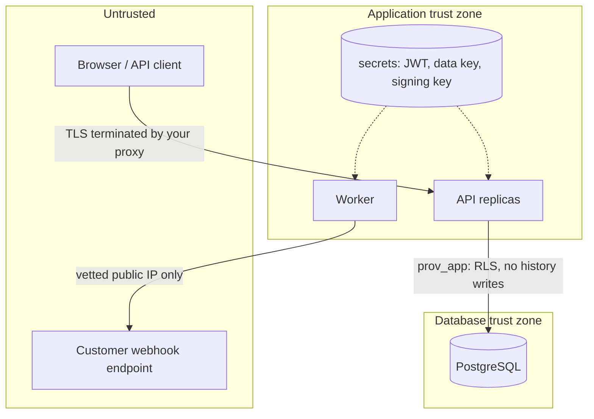

# Security

Security model, controls, and, just as important, what is *not* protected. Every control marked **(tested)** has an automated test; the test names are in [TESTING](TESTING.md).

## Trust boundaries

* The **application** decides who the caller is and which tenant they belong to (verified token or API key) and tells the database. The **database** enforces that decision (RLS) and guards history even if the application has a bug.
* The **signing key** for audit checkpoints and the **data key** live only in the application's environment, never in the database. A database-only compromise therefore cannot forge checkpoints or read webhook secrets.
* TLS is **not** terminated by the application. Run it behind a reverse proxy/load balancer that does, set `COOKIE_SECURE=true`, and forward the client address (`--proxy-headers`).

## Controls

### Authentication and sessions
| Control | Detail |
|---|---|
| Password hashing | Argon2id (argon2-cffi defaults), transparent rehash on login, constant-time-ish response for unknown emails **(tested)** |
| Passwords | **≥ 6 characters** enforced at sign-up, user creation and change (`MIN_PASSWORD` in `app/schemas.py`; a deliberate product choice for ease of use). Short passwords rely on Argon2id plus the login rate limits for protection. No breach-list or complexity checks; raise the minimum for regulated deployments. |
| Access tokens | JWT HS256, 15 min, `iss`/`exp`/`iat`/`sub`/`tid`/`ver` required; algorithm pinned (`alg: none`, wrong-key and wrong-tenant tokens rejected) **(tested)**. The role is **not** in the token; it is read from the database on every request. |
| Refresh tokens | Opaque, 48 random bytes, stored only as SHA-256, **rotated on every use**. Reuse of a rotated token (outside a 10 s race grace) revokes the whole login family and emits `security.refresh_token_reuse` **(tested)**. Delivered as an `HttpOnly; SameSite=Strict; Path=/api/v1/auth` cookie (`Secure` when configured), or in the body for non-browser clients. |
| Revocation | `token_version` on the user: password change, "sign out everywhere" and deactivation invalidate every outstanding access token immediately **(tested)**. |
| Brute force | Per-address and per-account login limits; 429 with `Retry-After` **(tested)**. |
| CSRF | The access token is a bearer header held in memory (not a cookie), so classic CSRF does not apply. The only cookie is the refresh cookie: `SameSite=Strict`, path-scoped, and the refresh endpoint returns tokens only to the caller. |

### Authorization
Granular permissions (`orders:write`, `audit:verify`, `webhooks:manage`, …) are grouped into four roles (`viewer`, `auditor`, `staff`, `admin`) in `app/auth.py`. Endpoints declare the permission they need; **API keys carry only the scopes they were issued** (`events:write`, `events:read`, `audit:read`, `audit:verify`, `audit:export`) and can never manage users, keys or webhooks, or call endpoints that record a human decision **(tested: RBAC matrix, key scopes)**. A test enumerates the OpenAPI spec and asserts every non-public endpoint rejects unauthenticated calls.

### Tenant isolation
Row-level security on every tenant table, fail-closed, transaction-local context, composite foreign keys, no BYPASSRLS role in use; cross-tenant read/write/move attempts all fail **(tested at API and SQL level)**, and a test fails if a new `tenant_id` table lacks a policy.

### API keys
`prv_<12-hex id>_<43-char secret>`; only SHA-256 of the secret is stored (the secret has 256 bits of entropy, so a fast hash is appropriate); shown once; constant-time comparison; optional expiry; revocation is immediate; per-key rate limit; last-used tracking **(tested)**.

### Input validation and injection
Pydantic models with `extra="forbid"`, length/pattern/range limits, enum-typed filters. All SQL is parameterised; the few dynamic fragments (column names in `UPDATE ... SET`) come from allow-lists or model field names, never from client text. `LIKE` searches escape wildcards. CSV export neutralises spreadsheet formula injection **(tested)**. The UI builds DOM nodes with `textContent` only (no `innerHTML`), under a CSP with `script-src 'self'` and no inline script or `eval`. The CSP also allows Google Fonts (`fonts.googleapis.com`, `fonts.gstatic.com`) for the Poppins typeface; self-host the font and drop those origins to avoid third-party requests.

### Transport and headers
CSP, `X-Content-Type-Options`, `X-Frame-Options: DENY`, `Referrer-Policy: no-referrer`, `Permissions-Policy`, COOP, HSTS (when `COOKIE_SECURE`), `Cache-Control: no-store` on API responses. Request bodies are capped (`MAX_REQUEST_BYTES`). CORS is off unless `CORS_ORIGINS` lists origins; wildcards are rejected in production. Swagger UI (`/docs`) loads its assets from a CDN and is exempt from the CSP; disable it with `DOCS_ENABLED=false` if that is unacceptable.

### Secrets and encryption
Required secrets (`JWT_SECRET`, `DATA_ENCRYPTION_KEY`, `CHECKPOINT_SIGNING_KEY`, database passwords) come from the environment; **there are no default secrets**, and the application refuses to start outside development if they are missing or weak (`Settings.problems()`) **(tested)**. Webhook signing secrets are encrypted at rest with AES-256-GCM, with the tenant bound as associated data so a ciphertext copied to another tenant fails **(tested)**. Passwords, refresh tokens and API-key secrets are hashed, never encrypted. Disk/backup encryption is the operator's responsibility (use encrypted volumes and encrypted backups). Key rotation is manual (see below).

### Webhook security
HTTPS only; no embedded credentials; every resolved address must be public (loopback, private, link-local, metadata, multicast, IPv4-mapped IPv6 all refused); the request is sent to the **vetted IP** with the original Host/SNI so DNS rebinding between check and use is blocked; redirects are never followed; checked again at *delivery* time, not only at creation **(tested, including rebinding)**. Signatures follow Standard Webhooks with a timestamp for replay protection and a stable id for deduplication; receivers must enforce a tolerance window (SDKs do).

### Activity log (who did what, from where)
`activity_log` records, per organization: sign-ins (success, wrong password, deactivated account), sign-up, sign-out, refresh-token reuse, **every change** (POST/PUT/PATCH/DELETE, whether it succeeded, was denied or failed), and sensitive reads (audit and activity exports, viewing the activity log, API-key and user lists, checkpoints). Each row has time, actor, action, method, route and path, HTTP status, outcome (`SUCCESS`/`DENIED`/`FAILURE`), **client IP address** (`inet`, filterable by address or CIDR block), user agent, request id and duration. **(tested)**
* **Only admins** can read or export it (`activity:read`); API keys can never hold that permission. Viewing and exporting it is itself recorded.
* **Nobody can change or delete it through the product:** there is no API to do so, the runtime role has only `SELECT`/`INSERT`, and a trigger rejects `UPDATE`, `DELETE` and `TRUNCATE` for every role including the table owner and superuser **(tested)**. A superuser can still disable that trigger; unlike `audit_log`, activity rows are *not* hash-chained, so such tampering would not be detectable after the fact. Ship the log to external storage (export or database log shipping) if you need that guarantee.
* **IP address accuracy:** the address is the TCP peer seen by the API. Behind a reverse proxy, start uvicorn with `--proxy-headers --forwarded-allow-ips <proxy address>` so the real client address is used; `X-Forwarded-For` from untrusted clients is ignored **(tested)**. Without that setting every row shows the proxy's address.
* **Not recorded:** sign-in attempts for emails that do not exist and requests with invalid credentials (no organization can be determined); they still appear, with IP, in the structured application log. Routine reads are not recorded unless `ACTIVITY_LOG_READS=true`.
* The log contains personal data (emails, IP addresses) and is never pruned automatically; set a retention policy that suits your jurisdiction.

### Audit history protection
The application role cannot write, update, delete or truncate `audit_log`, `audit_checkpoints`, `external_events`, `audit_chain_head` or call the sealing functions **(tested, 18 statements)**. An append-only trigger blocks even the table owner and superuser until they deliberately disable it; the hash chain and signed checkpoints are what make *that* detectable ([ARCHITECTURE](ARCHITECTURE.md#the-audit-chain)). Tampering tests cover edit, payload edit, mid-chain delete, tail truncation, re-ordering, unsealed insert, and a **full recompute of every hash**, which only checkpoints catch **(tested)**.

## Operating the keys

| Key | If lost | If leaked | Rotation |
|---|---|---|---|
| `JWT_SECRET` | users must sign in again | attacker can mint tokens for any user | change it; all sessions end. (No dual-key rollover yet.) |
| `DATA_ENCRYPTION_KEY` | webhook secrets are unreadable: rotate each webhook's secret | attacker with DB access can read webhook secrets | decrypt-and-re-encrypt migration needed (not provided); until then, rotating secrets per webhook re-encrypts with the current key |
| `CHECKPOINT_SIGNING_KEY` | new checkpoints use a new key; old ones are reported as "unknown key", not failures | attacker with DB write access could forge checkpoints | publish the new public key (`GET /audit/checkpoints`) and **keep the old public key** with your saved checkpoints |
| Database passwords | — | — | `ALTER ROLE` then redeploy; roles are re-asserted by `app.cli bootstrap` |

### Platform administration and break-glass
Platform operators are a separate identity population with mandatory TOTP MFA and their own token type; their database role (`prov_platform`) cannot read any tenant table. Emergency access to one organization requires a reason, a ticket, a second operator's approval and fresh MFA, is read-only in the database, expires automatically, cannot be extended, is logged before access in a separate signed platform audit chain, and is shown to the organization unless under a constrained legal hold. **(tested)** Details and limits: [PLATFORM_ADMIN](PLATFORM_ADMIN.md).

## Limitations and non-goals

Be clear-eyed about these.

1. **Arbitrary SQL execution as `prov_app` defeats tenant isolation.** The tenant is a session setting the application chooses; code that can run any SQL as `prov_app` can call `set_config('app.tenant_id', ...)`. RLS protects against *application bugs* (forgotten filters, bad joins, injected predicates in a single query) and defence-in-depth, not against a fully compromised API process. Keep the API's SQL parameterised and the process uncompromised; use separate databases per customer if you need stronger isolation.
2. **A database superuser can rewrite history** and the hash chain alone will not prove otherwise. Signed checkpoints held *outside* the system (webhook receiver, anchor file on storage DBAs cannot write, your own copy of a checkpoint) are the only thing that does. If you never keep a copy, you have tamper *evidence against ordinary users and the application*, not against a hostile DBA with the signing key.
3. **Provenance records what the database saw, not what is true.** Garbage in is faithfully recorded. External events carry the trust level an admin assigned to the source.
4. **Personal data and erasure.** Audit rows contain the values that changed (e.g. customer name and email) and the actor's email, and are append-only. Right-to-erasure requests conflict with that by design. Crypto-shredding or field redaction is **not implemented**; decide which fields belong in audited tables before you store regulated personal data.
5. **No MFA, SSO/SAML/OIDC, email verification or password reset.** Sign-up does not verify email ownership; a password reset must currently be done by an admin changing the user.
6. **No automatic key rotation, no HSM/KMS integration.** Keys come from environment variables; use your platform's secret manager to inject them.
7. **`/metrics` and `/ready` are unauthenticated** (they expose operational counters, not tenant data). Restrict them at the reverse proxy.
8. **Rate limiting trusts the peer address.** Behind a proxy, configure forwarded-header trust correctly or all clients share one bucket. Without Redis, limits are per process.
9. **Not independently audited or penetration-tested.** The test suite and static analysis (ruff, mypy, pip-audit in CI) are not a substitute.
10. **TLS, WAF, DDoS protection, network policy, disk encryption and backup encryption** are deployment concerns outside this repository.

## Reporting a vulnerability
Open a private security advisory on the repository or email the maintainers listed there. Please do not file public issues for vulnerabilities.
